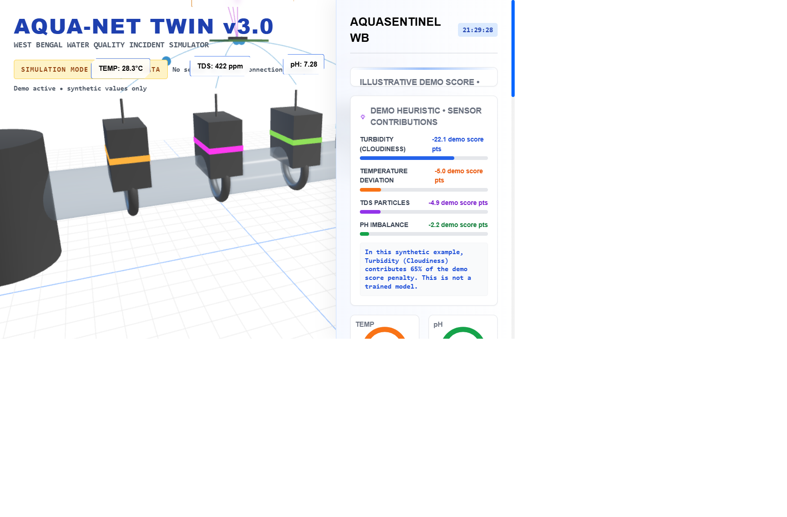

# JALDRISHTI — AquaSentinel WB

A browser-based, research-oriented **water-quality incident simulation prototype** for West Bengal. The dashboard demonstrates a synthetic turbidity incident and an illustrative sensor-score heuristic. It is not connected to sensors, does not transmit data, and does not establish whether water is safe to drink.

> **Safety notice:** This repository contains no field measurements, laboratory results, validated sensor calibration, deployment evidence, or certification. pH, TDS, turbidity, and temperature sensors cannot directly detect arsenic, fluoride, or pathogens. Do not use this prototype to make treatment, health, or drinking-water decisions.

## Screenshot



The screenshot is of the local demonstration interface. All values shown are synthetic.

## What is in this repository

- **Static web demo:** a Three.js pipe/sensor visualization, animated illustrative telemetry, a Chart.js plot, and a turbidity incident/reset workflow.
- **Separated simulation logic:** scenario state, bounded synthetic readings, and score calculations in `src/scenarios.js`, with Node.js built-in unit tests.
- **ESP32 firmware reference:** a serial-only Arduino/ESP32 sketch that samples four analog inputs and emits averaged ADC millivolt estimates. It does not convert them to pH, TDS, NTU, or temperature.
- **Engineering documentation:** architecture, incident workflow, hardware assumptions, validation and deployment notes, and an evidence register that distinguishes missing evidence from established facts.

There is **no** backend, cloud service, database, authentication, browser-to-firmware bridge, AI model, or live telemetry. The ESP32 firmware is not connected to the dashboard.

## Current stack

| Area | Technology |
|---|---|
| Dashboard | HTML, CSS, ES modules, vanilla JavaScript |
| 3D scene | Three.js `0.150.1` and its OrbitControls add-on |
| Chart | Chart.js `4.4.7` |
| Utility styling | Tailwind Play CDN `3.4.17` |
| Fonts | Orbitron and Rajdhani from Google Fonts, with local system-font fallbacks |
| Frontend tests | Node.js built-in test runner; no npm runtime dependencies |
| Firmware | Arduino framework on PlatformIO `espressif32@6.10.0`, generic `esp32dev` target |
| CI | GitHub Actions: JavaScript checks/tests and firmware compile |

The browser demo loads Three.js, Chart.js, Tailwind, and fonts from CDNs; an internet connection is needed for the full visual experience. The Tailwind Play CDN is intended for prototypes, not production deployments. There are no package-lock files because the frontend declares no npm packages.

## Windows setup and run

Prerequisites: Windows 10/11, Node.js 20 or newer, npm (bundled with Node), Python 3, and a current browser with ES-module/import-map and WebGL support.

Open PowerShell in the repository folder:

```powershell
node --version
npm --version
npm run check
npm test
py -m http.server 8000 --bind 127.0.0.1
```

In a browser, open <http://127.0.0.1:8000>. Keep the PowerShell server window open while using the demo; press `Ctrl+C` to stop it. Do not open `index.html` directly with `file://`: the app uses JavaScript modules and an import map, which require an HTTP origin.

No `npm install` is required. The unit tests and syntax checks use Node.js built-ins only.

### Firmware build (optional)

Firmware is a separate reference example and is not required to run the web demo. To install the pinned PlatformIO CLI and compile it:

```powershell
py -m pip install platformio==6.1.18
pio run --project-dir .\firmware
```

To list serial ports and monitor a connected board (replace `COM3` as appropriate):

```powershell
pio device list
pio device monitor --project-dir .\firmware --port COM3 --baud 115200
```

To upload after confirming the board and wiring:

```powershell
pio run --project-dir .\firmware --target upload --upload-port COM3
```

**Do not connect sensor outputs until the exact sensor-interface board datasheets and output voltages have been checked.** The firmware sketch reports raw ADC input only. Read [hardware notes](hardware/README.md) and [firmware notes](firmware/README.md) first.

## Demo walkthrough

1. Start the local HTTP server and open the dashboard.
2. Observe the persistent **SIMULATION MODE • NOT LIVE DATA** label and disconnected ESP32/cloud markers.
3. Use **Run scenario** to show the synthetic turbidity-triggered investigation workflow.
4. Use **Reset baseline** to restore the synthetic baseline scenario.
5. Orbit the 3D scene with the mouse/touch controls; the plotted values and displayed readings continue to vary within the demo logic.

The turbidity trigger (`5 NTU`) and scenario readings (`18.4 NTU` incident, `2.2 NTU` baseline) are illustrative software constants, not measured samples or a universal regulatory limit. The numeric “demo score” is an arbitrary interface heuristic, not a validated water-quality index or a prediction.

## Architecture and data flow

```text
Browser
  index.html
    ├── src/app.css             Layout and visual styling
    ├── src/app.js              Three.js scene, chart, DOM, animation
    └── src/scenarios.js        Synthetic scenario state and demo-score math
          └── tests/scenarios.test.js

Separate, optional reference firmware
  ESP32 ADC pins → averaged raw-millivolt JSON lines → USB serial monitor
  (no parser, network, storage, or connection to the browser dashboard)
```

See [architecture and data flow](docs/architecture.md), [hardware assumptions](hardware/README.md), and [firmware details](firmware/README.md).

## Hardware and software technical details

### Software

- `index.html` supplies the dashboard markup, versioned CDN references, import map, and ES-module entry point.
- `src/app.js` owns the WebGL scene, animated particles, Chart.js plot, accessible DOM updates, and scenario controls.
- `src/scenarios.js` is the pure simulation boundary. It validates ranges and scenario names, resets values, advances synthetic readings, and calculates the demo score.
- `tests/scenarios.test.js` checks the default incident, reset values, bounds, score range, and invalid input handling.
- The frontend makes no fetch/XHR/WebSocket requests to a project server and uses no browser storage.

### Hardware (proposed, unvalidated reference only)

The original project contained only a visual ESP32 illustration—no board, sensor models, pin map, wiring, or firmware. The new firmware assumes a classic ESP32 DevKit/WROOM-style target using ADC1 GPIOs 34, 35, 32, and 33. Those pin assignments and the PlatformIO `esp32dev` target must be checked against the exact board revision before use.

| Firmware channel | GPIO | Signal currently emitted |
|---|---:|---|
| pH interface output | 34 | ADC millivolt estimate only |
| TDS interface output | 35 | ADC millivolt estimate only |
| Turbidity interface output | 32 | ADC millivolt estimate only |
| Temperature interface output | 33 | ADC millivolt estimate only |

These are **provisional MCU pin assignments**, not wiring instructions for unspecified sensor modules. Never connect a pH electrode directly to an ESP32 ADC. Use a suitable high-impedance pH interface. Use the vendor’s TDS interface for its conductivity probe. Verify that every interface output stays within the ESP32 board’s permitted input range across startup and fault conditions; ESP32 GPIO inputs are not 5 V tolerant. A divider/buffer or separate ADC may be required, and its design depends on the selected module. Check polarity, grounding, supply voltage, isolation, and enclosure requirements against the board/module datasheets before powering anything.

No exact sensor BOM, prices, tolerances, materials, power budget, water-contact enclosure, or calibration constants are claimed. See the [hardware checklist](hardware/README.md) for procurement and calibration gates.

## Tests and checks

Run locally:

```powershell
npm run check
npm test
pio run --project-dir .\firmware
```

The first two commands are dependency-free. The firmware command requires PlatformIO and downloads the pinned ESP32 platform/toolchain. GitHub Actions runs all three checks on pushes and pull requests. A firmware compile only checks compilation; it does not verify physical wiring, sensor accuracy, calibration, or water safety.

An interactive browser smoke test was run over the local HTTP server: the incident/reset controls displayed the configured scenario values, a 390 px viewport had no horizontal document overflow, and no JavaScript console errors were captured. The environment blocked the external Google Fonts request (system fallbacks were used); Tailwind emitted its expected Play CDN production-use warning. This does not constitute a cross-browser or device test; see [validation status](docs/validation.md).

## Safety limitations and incident response

- This is a demonstration and educational/research prototype, not an operational monitoring service or medical/public-health device.
- Temperature, pH, TDS, and turbidity readings alone do not measure arsenic, fluoride, iron, pathogens, or every other hazard. In particular, they cannot establish potability.
- TDS is not a contaminant-specific measurement; turbidity is not a pathogen test.
- Sensor interfaces require model-specific wiring, calibration, maintenance, temperature compensation where appropriate, and validation against a suitable reference method. None has been performed or claimed here.
- A simulated threshold crossing is only an investigation workflow prompt. Confirm readings and samples using applicable local procedures and an appropriately authorised laboratory; follow the responsible water operator/local authority’s advice.
- Never display synthetic values as live measurements, present the heuristic as a validated index, or tell users water is safe to drink based on this system.

For the full non-operational workflow, see [incident response](docs/incident-response.md). For missing source material, see the [research evidence register](docs/research-evidence.md).

## Repository map

```text
.
├── .github/
│   ├── ISSUE_TEMPLATE/
│   ├── PULL_REQUEST_TEMPLATE.md
│   └── workflows/checks.yml
├── docs/
│   ├── architecture.md
│   ├── deployment.md
│   ├── incident-response.md
│   ├── research-evidence.md
│   └── validation.md
├── firmware/
│   ├── platformio.ini
│   ├── README.md
│   └── src/main.cpp
├── hardware/README.md
├── src/
│   ├── app.css
│   ├── app.js
│   └── scenarios.js
├── tests/scenarios.test.js
├── index.html
├── package.json
├── CONTRIBUTING.md
├── CODE_OF_CONDUCT.md
├── CHANGELOG.md
├── SECURITY.md
└── README.md
```

## GitHub publishing

The current working branch is `feature/rebuild-simulator`; this workspace was initialized locally and has no remote configured. Review the files and tests, then create an empty GitHub repository under the appropriate account/organization. Add its URL as `origin`, inspect it, and push only after confirming the repository contains no secrets:

```powershell
git remote add origin https://github.com/<OWNER>/<REPOSITORY>.git
git remote -v
git status --short --branch
git diff --check
git add .
git diff --cached --check
git diff --cached --stat
git commit -m "Rebuild AquaSentinel simulator with documented prototype firmware"
git push -u origin feature/rebuild-simulator
```

Open a pull request for review before merging. Do not publish field data, credentials, private keys, or a claim of field validation. No commit, push, release, or deployment is performed by this project setup.

## Before any controlled pilot

The checklist is intentionally not a deployment approval. At minimum, the team still needs to select and document exact sensor/interface models; design and electrically review the front end, isolation, power, enclosure, and water-contact materials; implement and validate model-specific conversions and calibration; compare measurements against reference methods with uncertainty and drift analysis; determine applicable permissions, safety procedures, and laboratory confirmation; perform a privacy/threat assessment and define data retention/access controls before adding connectivity; and complete controlled bench/field validation under qualified supervision. See [validation gaps](docs/validation.md).

## License and third-party software

No project license or original research license was present in the supplied file, so no project-wide reuse license is asserted. Third-party dependencies remain subject to their own licenses and terms; see [third-party notices](docs/third-party-notices.md). Obtain permission or license review before redistributing material not authored by this project.
